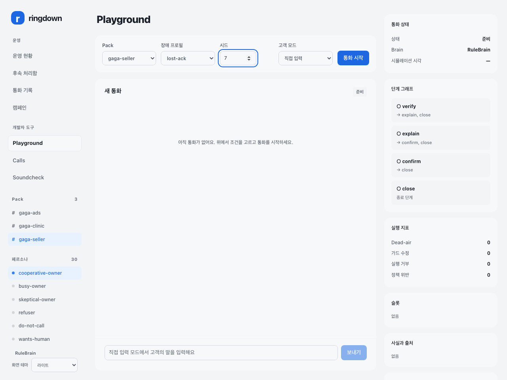
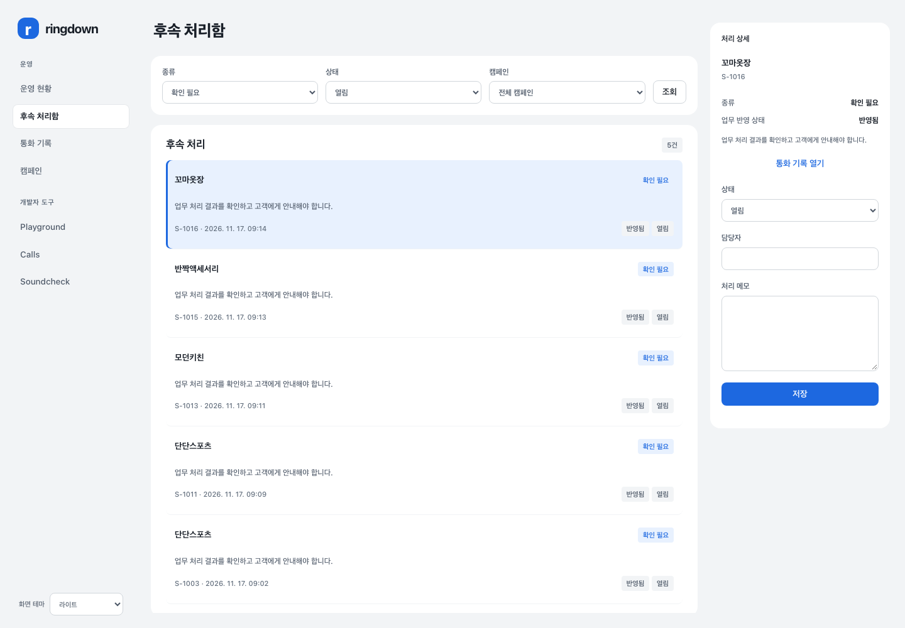

# Ringdown

조직마다 다른 지식, 정책, 업무 시스템에 AI 콜 에이전트를 붙이는 엔진입니다. 조직 하나는 설정 묶음(Pack) 하나이고, 엔진 코드는 바뀌지 않습니다. 출시 전에는 업무 시스템이 느리거나 죽거나 응답을 잃는 상황을 시뮬레이션으로 돌려 숫자로 확인합니다.



가상 판매자와 직접 대화한 통화입니다. 마지막 장면에서 반품 정책 쓰기의 응답이 사라지자(`unknown_outcome`) 런타임이 같은 멱등 키로 한 번 더 요청하고, 업무 시스템은 이미 반영된 결과를 돌려줍니다. 이중 반영도 거짓 완료 안내도 없습니다.

## 설계 원칙

**두뇌는 제안하고 런타임이 결정합니다.** 규칙이든 LLM이든 두뇌는 할 말, 부를 도구, 다음 단계를 제안만 합니다. 실행은 결정론 런타임이 검사한 뒤에 합니다.

- 쓰기는 고객 동의, 필요한 값, 같은 계획 안의 중복을 실행 전에 검사합니다.
- 수신 거부와 확인 대기는 런타임만 정할 수 있습니다. 두뇌가 고를 수 없습니다.
- 통화 성공은 두뇌의 선언이 아니라 업무 시스템의 최종 상태로 판정합니다.
- 응답 없는 쓰기는 성공이나 실패로 처리하지 않습니다. '결과 모름'으로 두고 같은 멱등 키로만 재시도합니다.

**조직 추가는 디렉터리 하나입니다.** 새 조직은 `packs/<org>/`에 목표, 정책, 단계 그래프, 업무 시스템 연결, 지식 문서를 담습니다. 엔진 코드에 조직 이름이 나오면 CI가 막습니다. 세 번째 조직인 가가클리닉은 `src/`, `web/`, `scripts/`를 한 줄도 고치지 않고 붙였습니다([온보딩 기록](docs/experiments/2026-11-m5-onboarding.md)).

**출시 판단은 시뮬레이션 숫자로 합니다.** Soundcheck는 Pack마다 30명의 가상 고객과 장애 프로파일(`clean`, `slow`, `flaky`, `down`, `lost-ack`)을 곱해 통화를 돌리고, 목표 달성률의 Wilson 95% 구간과 정책 위반 건수로 합격선을 판정합니다([Soundcheck](docs/SOUNDCHECK.md)).

## 로컬 LLM을 두뇌로 쓴 결과

로컬 LLM 두 종(Qwen3 8B, Gemma3 12B)을 같은 런타임에 넣었습니다. 처음 비교에서는 둘 다 목표 달성률 0%였습니다. 파일럿을 열 번 돌리며 실패 원인을 하나씩 고친 뒤 결과는 다음과 같습니다.

| Pack | 규칙 두뇌 | Qwen3 8B | Gemma3 12B |
|---|---|---|---|
| gaga-ads | 50.0% | 45.0% | 30.0% |
| gaga-clinic | 33.3% | 25.0% | 35.0% |
| gaga-seller | 48.3% | 46.7% | 48.3% |

Pack마다 clean과 flaky 장애에서 60통화씩입니다. 두 모델 모두 세 Pack에서 규칙 두뇌와 신뢰구간이 겹치고, 시드를 바꾼 재실행에서도 같았습니다. 정책 위반은 0건입니다.

고친 것 대부분은 모델을 똑똑하게 만든 것이 아닙니다. 잘못된 값을 고를 수 없게 생성 스키마를 좁혔고, 런타임이 거부할 때 고칠 방법을 함께 돌려줬습니다. 이 과정에서 규칙 두뇌로는 드러나지 않던 엔진 빈틈 두 개를 찾아 막았습니다.

1. 두뇌가 협조적인 고객의 통화를 수신 거부로 끝낼 수 있었습니다.
2. 한 계획에 같은 쓰기를 두 번 넣으면 멱등 키가 달라 이중 반영됐습니다. 평가 단계의 정책 위반 집계가 잡았습니다.

회차별 관찰, 고친 커밋, 지연 시간, 한계는 [M4 재실험 보고서](docs/experiments/2026-11-m4-rerun.md)에 있습니다. 프롬프트는 이 세 Pack의 파일럿을 보며 조정했으므로 새 Pack에 대한 일반화는 아직 확인하지 않았습니다.

## 빠른 시작

```bash
npm ci
npm run ci          # 타입 검사, lint, 테스트, 경계 검사, Pack 검증, smoke
npm run play        # http://localhost:4310 운영 콘솔과 Playground
npm run ringdown -- call --pack packs/gaga-seller --persona cooperative-owner --faults lost-ack --seed 7
```

LLM, 실제 전화, 외부 업무 API 없이 돌아갑니다. 로컬 LLM은 Ollama를 설치한 뒤 `--brain llm`으로 고릅니다.

## Pack

| Pack | 통화 목적 |
|---|---|
| `packs/gaga-seller` | 판매자에게 비어 있는 반품 배송비 정책을 안내하고 설정 |
| `packs/gaga-ads` | 광고주에게 자동충전을 권하고 설정 |
| `packs/gaga-clinic` | 이름과 접수 경로를 확인한 뒤 예약 유지, 시간 변경, 취소. 의료 질문은 사람에게 이관 |

```
packs/gaga-seller/
  pack.yaml        목표, 정책, 단계 그래프, 도구, 합격선
  jacks.yaml       업무 시스템 연결 (mock 또는 http-json)
  mock.yaml        선언형 mock 업무 시스템
  personas.yaml    Soundcheck 통화 상대
  kb/*.md          조직 지식
```

가가마켓, 가가애즈, 가가클리닉과 모든 고객은 가상입니다. 클리닉의 본인 확인은 키워드 기반 시뮬레이션이며 실제 인증을 입증하지 않습니다.

## 운영 콘솔



캠페인으로 대상 고객에게 통화를 돌리고, 통화 기록과 요약을 검색합니다. 상담원 연결, 콜백, 확인 필요 건은 후속 처리함에 모입니다. **반영됨 / 반영 안 됨**은 통화에 저장된 업무 상태와 쓰기 기록을 대조한 결과입니다.

## 문서

- [사용법](docs/USAGE.md): CLI 통화, 운영 콘솔과 API, Playground, 로컬 LLM 설정
- [설계](docs/DESIGN.md), [Soundcheck](docs/SOUNDCHECK.md), [온보딩 절차](docs/ONBOARDING.md)
- [진행 상황](docs/PROGRESS.md)과 [실험 기록](docs/experiments/)
