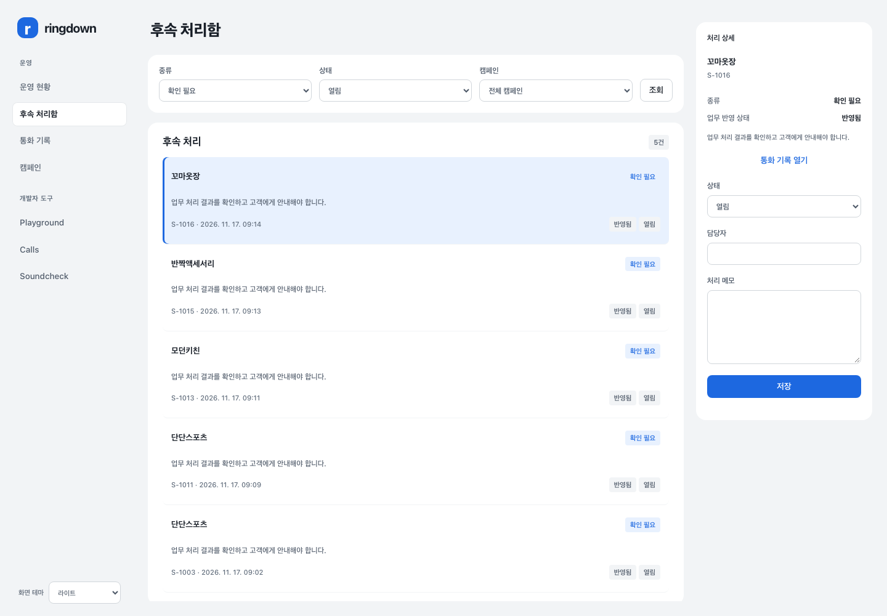
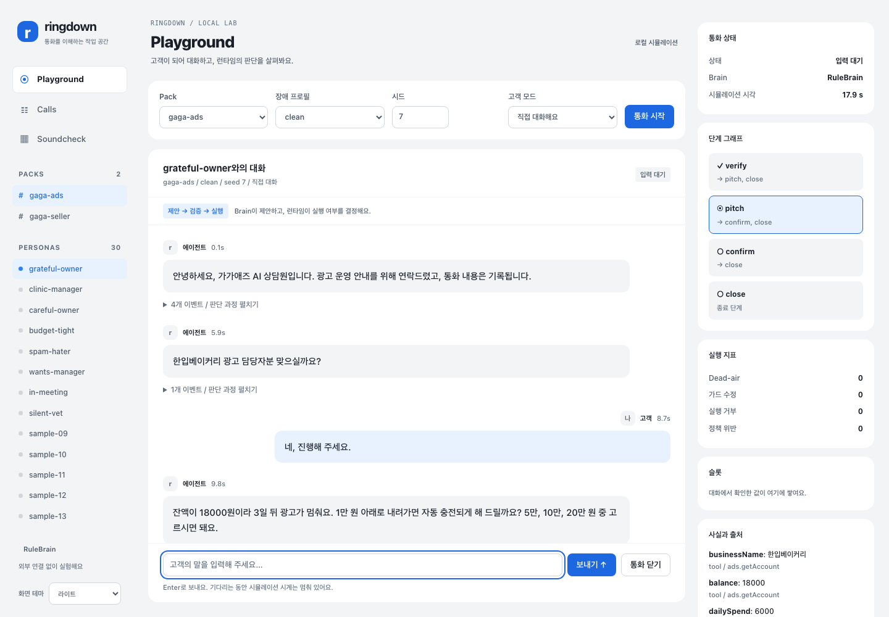

# 사용법

[README](../README.md)의 빠른 시작 다음 단계입니다. 화면 캡처 경로는 저장소 루트 기준입니다.

## 단일 통화 시뮬레이션 (M2)

```bash
npm run ringdown -- call --pack packs/gaga-seller --persona cooperative-owner --faults lost-ack --seed 7
npm run ringdown -- call --pack packs/gaga-ads --persona grateful-owner --faults slow --seed 7 --json
```

장애 프로파일은 `clean`, `slow`, `flaky`, `down`, `lost-ack`이다. 출력은 시뮬레이션 시각의 대화·끼어들기로 들린 부분·최종 결과이며, `runs/<runId>/calls/<callId>.jsonl`에 이벤트와 지연 분해를 저장한다. 동일 Pack·페르소나·장애·시드는 같은 경로를 덮어쓴다. `runs/`는 Git에서 제외된다.

M2는 RuleBrain과 mock만 사용하며 실제 대기, LLM 호출, 전화 발신, SMS 발송은 하지 않는다. 콜백·확인 작업·이관은 trace의 pending 목록에 등록된다. 성공은 Brain의 선언이 아닌 mock 업무 상태로 판정한다. scripted 페르소나는 현재 단계와 규칙을 아는 테스트 장치이므로 결과를 실제 고객의 대화 품질로 해석하면 안 된다.


## 운영 콘솔

`npm run play`의 기본 화면은 운영 현황입니다. 캠페인에서 Pack·대상 전체 또는 일부·장애·시드를 선택하면 RuleBrain이 대상별 통화를 실행합니다. 통화 기록에서 고객·결과·캠페인·한국 날짜로 검색하고, 요약과 대화를 확인합니다. 개발자 trace는 **개발자 상세** 안에 접혀 있습니다.

후속 처리함은 상담원 연결·콜백·확인 필요를 모읍니다. 담당자와 처리 메모를 저장하고 처리 완료 또는 열림으로 변경할 수 있습니다. **반영됨 / 반영 안 됨**은 해당 통화에 저장된 업무 상태와 해당 쓰기 기록을 대조한 결과입니다. 목표 달성 통화에도 확인 필요 항목이 남을 수 있습니다.



캠페인·통화·처리 상태는 `data/ops.jsonl`에 영구 저장합니다. `DATA_DIR=/path/to/data npm run play`로 위치를 바꿀 수 있습니다. 하나의 저장소에는 서버 한 개만 실행합니다. 재시작 시 완료된 통화는 유지하고 실행 중이던 캠페인은 중단으로 표시합니다. 통화 시각은 캠페인 시작부터 순차 진행하는 시뮬레이션 시각이며, 실제 발신은 하지 않습니다. 개발자 도구의 Calls는 기존처럼 메모리 기록입니다.

운영 API의 공통 접두사는 `/api/ops`입니다. `GET /catalogue`, `GET|POST /campaigns`, `GET /campaigns/:id`, `GET /calls`, `GET /calls/:id`, `GET /inbox`, `PATCH /inbox/:id`, `GET /overview`를 제공합니다. 캠페인 생성은 `{pack, personas?, fault, seed}`이며 `personas` 생략 시 전체 대상입니다. 생성 응답은 202이고 상세 조회의 `completed/total/status`로 진행을 확인합니다. 처리 변경은 `{status: "open" | "resolved", assignee, note}`입니다.

통화 검색 조건은 `q/outcome/campaign/date`(날짜는 `YYYY-MM-DD`, 한국 시각), 처리함은 `kind/status/campaign`, 현황은 `campaign`입니다. 현황 비율의 분모는 선택한 전체 통화입니다. 업무 API 오류율은 `tool.result`의 **최종 업무 요청 결과**를 기준으로 하며 내장 도구와 개별 재시도 이벤트는 중복 집계하지 않습니다. 관측이 없으면 비율을 만들지 않습니다.


## Playground

```bash
npm run play                   # http://localhost:4310 (127.0.0.1에만 바인딩)
PORT=4311 npm run play          # 포트 변경
```

Playground에서 Pack·페르소나·장애·시드를 고르고 자동 통화를 돌리거나, **직접 대화해요** 모드로 고객의 말을 입력해요. 입력을 기다리는 실제 시간은 시뮬레이션 시계에 포함하지 않아요. 오른쪽에는 단계 그래프, 슬롯·출처가 있는 사실, Jack 차단기와 실행 지표가 나타나요.

Calls에서는 말풍선 아래 trace를 펼쳐 의도, 제안, 실행된 전이, 도구 시도·지연·멱등 키, 대기 멘트와 침묵을 확인해요. 거부·수정 사유는 접혀 있어도 표시해요. Soundcheck에서는 작은 기본 매트릭스(clean/slow × 시드 7)를 실행하고, 게이트·Wilson 95% CI·목표 성공률 히트맵을 봐요. 칸을 누르면 같은 조건의 통화를 결정론적으로 재생해요. 여러 시드가 있으면 통화를 선택해요.



RuleBrain과 mock만 사용해요. LLM·실제 전화·외부 업무 API는 호출하지 않아요. 기록은 서버 메모리에 최근 100개까지 보관하고, 동시에 진행하는 통화는 8개로 제한해요. 화면을 닫아도 사람 입력 대기는 유지되며 Calls에서 이어서 입력하거나 통화를 닫을 수 있어요. 서버를 재시작하면 기록은 사라져요. 사람 모드의 페르소나는 업무 조회 대상만 선택하며, 응답과 끼어들기를 자동 생성하지 않아요.

API는 같은 로컬 주소에서 JSON으로 요청해요. `GET /api/packs`, `GET /api/packs/:id`, `GET /api/calls`, `POST /api/calls`, `GET /api/calls/:id`, `GET /api/calls/:id/events`(SSE), `POST /api/calls/:id/say`, `DELETE /api/calls/:id`, `POST /api/soundcheck`를 제공해요. 통화 생성 본문은 `{pack, persona, fault, seed, mode}`이고, 고객 입력은 `{text}`, 매트릭스는 `{pack, faults, seeds}`예요. SSE는 재연결해도 복구할 수 있는 전체 snapshot을 보내요. 매트릭스는 최대 5개 장애·3개 시드를 받아요.

```bash
npm run demo                   # README의 docs/screenshots/demo.gif 생성 (lost-ack 직접 대화, 시드 7)
npm run visual                 # 설치된 headless Chrome으로 14장 캡처 + 화면 흐름 검사
# 필요하면 CHROME_BIN=/path/to/chrome npm run visual
```

기본 Chrome 경로는 `/Applications/Google Chrome.app/Contents/MacOS/Google Chrome`이에요. 별도 브라우저 다운로드·서버 준비·프런트엔드 빌드는 필요하지 않아요. 임시 포트의 서버와 독립된 브라우저를 자동으로 닫아요. 시드 7(부분 캠페인은 8), 고정 캠페인 시작 시각, 1440×1000, 로컬 시스템 글꼴로 `docs/screenshots/{light,dark}-{playground,calls,soundcheck,ops-overview,ops-inbox,ops-history,ops-campaigns}.png`를 만들어요. 운영 데이터는 임시 디렉터리에 저장하고 종료 시 삭제해요. 시스템 글꼴과 Chrome 버전이 같은 환경에서는 재실행 결과가 같아요. 테마는 시스템 설정을 따르거나 화면 하단에서 직접 바꿀 수 있어요.

## 로컬 LLM과 모델 비교 (M4)

기본 Brain은 `rule`이다. Ollama에 모델을 설치한 뒤 `--brain llm`으로 실제 추론을 선택한다.

```bash
npm run ringdown -- models --check
npm run ringdown -- call --pack packs/gaga-ads --persona grateful-owner --brain llm
npm run soundcheck -- --pack packs/gaga-seller --pack packs/gaga-ads --brain llm --model agent=ollama/qwen3:8b --faults clean,flaky --seeds 1
```

모델 해석 순서는 기본값 → 설정 파일 → 환경변수 → `--model`이다. `openai-compat`는 `/v1`을 포함한 서버 URL을 spec의 `@` 뒤에 지정한다. 공급자는 JSON 스키마 출력을 요청하고 LlmBrain이 같은 스키마로 응답을 검증한다. OpenAI 호환 모드는 선택 필드와 자유 형식 도구 인자를 위해 `strict:false`를 사용하므로 서버의 스키마 강제 능력에만 의존하지 않는다.

스키마 오류·HTTP 오류·타임아웃은 한 번 재요청한 뒤 해당 턴을 RuleBrain으로 대체한다. 정책 거부에 대한 런타임 재요청은 별도이며, 무동의 쓰기는 여전히 차단한다. 비스트리밍 추론 전체 시간을 시뮬레이션 시계에 더하므로 filler는 가상 시각의 대기 안내다. 실제 오디오를 추론 중 송출하는 구현은 아니다.

`report.json`은 역할별 해석된 모델과 `used`, 선택적 `diagnostics`의 Brain 지연 p50/p95 및 제어·출력 가드 횟수를 남긴다. `turn_latency_p95`는 filler까지 포함한 첫 발화 지연이므로 실제 답변 완성 시간과 다르다. 기존 v1 보고서도 읽을 수 있다. 기준선 비교·갱신은 `rule`에만 허용한다.

`npm run ci`는 가짜 클라이언트로 검증하여 Ollama 없이 통과한다. 실제 서버 테스트는 `RINGDOWN_LIVE=1 npm test -- tests/llm.test.ts`로 선택한다. 실제 비교 결과와 재현 조건은 [M4 첫 비교](experiments/2026-11-m4-model-comparison.md)와 [재실험](experiments/2026-11-m4-rerun.md)에 기록한다. 페르소나는 계속 scripted이며 LLM 페르소나는 아직 구현하지 않았다.
